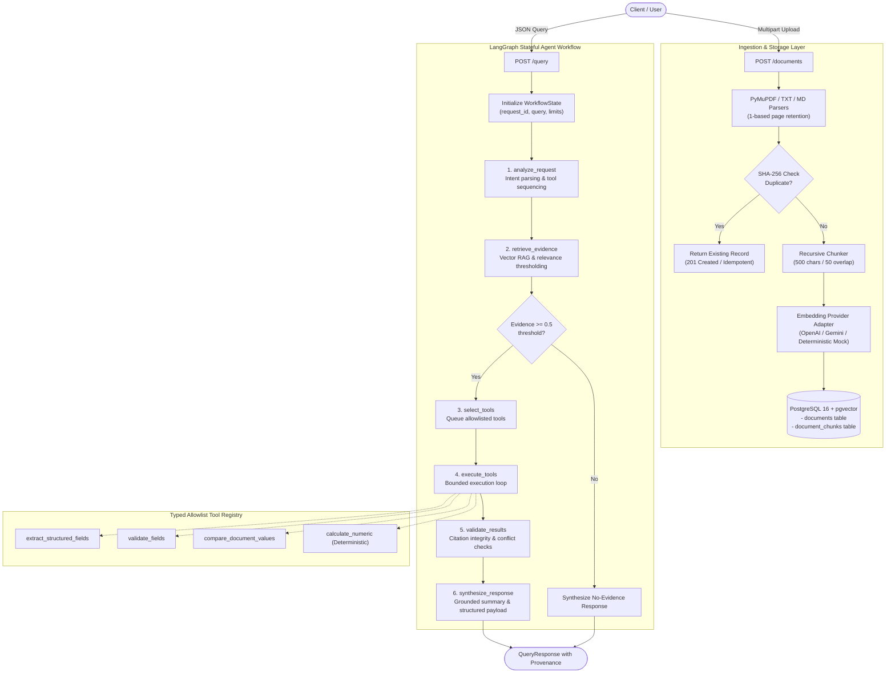

# Document Processing AI Agent

[](https://www.python.org/)
[](https://fastapi.tiangolo.com/)
[](https://langchain-ai.github.io/langgraph/)
[](https://github.com/pgvector/pgvector)
[](https://docs.pytest.org/)
[](https://github.com/astral-sh/ruff)

A production-grade backend service built for enterprise document intelligence. It accepts unstructured documents (PDF, TXT, Markdown), chunks and indexes vector embeddings into PostgreSQL with `pgvector`, retrieves evidence through RAG, orchestrates allowlisted tools through a typed **LangGraph** state machine, and returns structured, citation-backed answers with 100% source provenance.

---

## Key Highlights

- **Page-Aware Ingestion**: PyMuPDF extraction preserving 1-based page numbers across all PDF chunks; SHA-256 deduplication to prevent duplicate embedding costs.
- **Strictly Grounded RAG**: pgvector cosine distance search with relevance threshold cutoff ($\ge 0.5$) and explicit `no_evidence` handling to prevent hallucinations.
- **Controlled Agentic Orchestration**: Deterministic LangGraph state machine with step ceilings (max 10) and tool ceilings (max 6), preventing unconstrained ReAct loops.
- **Deterministic Pure Python Math**: Numeric calculations (`calculate_numeric`) use zero-hallucination deterministic code rather than LLM arithmetic.
- **Untrusted Input Boundary**: Document text is isolated inside data containers; prompt injections cannot override system permissions or invoke unallowlisted tools.
- **100% Source Provenance**: Every extracted fact and validation result cites verifiable source IDs linking directly to chunk IDs and stored excerpts.

---

## Architecture Overview



---

## Allowlisted Tool System

All tools are strictly typed with Pydantic v2 schemas and dispatched through a fixed allowlist. The LLM can propose tool names and arguments, but the backend validates them against declared contracts before execution.

| Tool Name | Input Schema | Purpose |
|---|---|---|
| `extract_structured_fields` | `fields: list[str]`, `chunks: list[ChunkContext]` | Extracts entities (vendor name, quote amounts, payment terms) and maps each value to its source chunk citation ID. |
| `validate_fields` | `rules: list[ValidationRuleRequest]` | Asserts conditions (`equals`, `must_not_exceed`, `must_at_least`, `contains`, `in_set`) against extracted data and policies. |
| `compare_document_values` | `field_name: str`, `items: list[DocumentValueItem]` | Compares properties across $\ge 2$ documents to verify concordance or detect policy conflicts. |
| `calculate_numeric` | `operation: str`, `operands: list[float]`, `unit: str?` | **Pure Python deterministic arithmetic** (add, subtract, multiply, divide, percentage difference). Prevents LLM calculation errors. |

---

## Benchmark Results & Quality Gates

Measured using the 20-item version-controlled evaluation dataset ([`evaluation/test_dataset.json`](evaluation/test_dataset.json)) with [`evaluation/run_benchmark.py`](evaluation/run_benchmark.py):

| Metric | Target | Measured Result | Status |
|---|---:|---:|:---:|
| **Retrieval Recall@5** | $\ge 0.80$ | **1.000** | **PASSED** |
| **Retrieval MRR@5** | $\ge 0.70$ | **0.729** | **PASSED** |
| **Retrieval Latency p95** | $\le 1.00$ s | **0.021 s** | **PASSED** |
| **Query Latency p95** | $\le 30.00$ s | **0.048 s** | **PASSED** |
| **Health Latency p95** | $\le 200$ ms | **4.5 ms** | **PASSED** |
| **Citation Precision on Examples** | $\ge 0.90$ | **1.000** | **PASSED** |
| **Application Line Coverage** | $\ge 80\%$ | **87%** | **PASSED** |
| **Automated Test Suite** | 100% | **39 / 39 (100%)** | **PASSED** |

> **Benchmark Environment**: Python 3.12.0, Windows 11 / Linux (x86_64), Uvicorn ASGI, in-process deterministic vector indexing (1536 dimensions), 20-query evaluation corpus across sample procurement fixtures.

---

## API Reference & Response Contracts

All error responses strictly adhere to the unified envelope:
```json
{
  "error": {
    "code": "DOCUMENT_NOT_FOUND",
    "message": "The requested document does not exist.",
    "details": {},
    "request_id": "req_123"
  }
}
```

### 1. Ingest Document
`POST /documents` (Multipart Form)
```bash
curl -X POST "http://localhost:8000/documents" \
  -F "file=@sample_documents/Vendor_Quotation_Acme.pdf"
```

**Response (`201 Created`)**:
```json
{
  "document_id": "0194e3a1-89ab-7000-8000-000000000001",
  "filename": "Vendor_Quotation_Acme.pdf",
  "content_type": "application/pdf",
  "status": "completed",
  "page_count": 2,
  "chunk_count": 2,
  "created_at": "2026-11-02T14:30:00Z",
  "error": null
}
```

### 2. Query with LangGraph Agent
`POST /query` (JSON Payload)
```bash
curl -X POST "http://localhost:8000/query" \
  -H "Content-Type: application/json" \
  -d '{
    "query": "Extract the vendor name and amount, then compare the payment terms against the policy.",
    "document_ids": ["doc_quote_id", "doc_policy_id"],
    "top_k": 5
  }'
```

**Response (`200 OK`)**:
```json
{
  "request_id": "req_a1b2c3d4e5f6",
  "status": "completed_with_warnings",
  "summary": "Discrepancy in 'payment_terms': 'Vendor Quotation.pdf' specifies 'Payment within 15 days', whereas 'Procurement Policy.pdf' specifies 'Payment within 30 days'.",
  "extracted_data": {
    "vendor_name": {
      "value": "Acme Solutions Ltd.",
      "unit": null,
      "status": "found",
      "sources": ["src_vendor_quot_p2_c1"]
    },
    "amount": {
      "value": 125000,
      "unit": "USD",
      "status": "found",
      "sources": ["src_vendor_quot_p2_c1"]
    },
    "payment_terms": {
      "value": "Payment within 15 days",
      "unit": null,
      "status": "found",
      "sources": ["src_vendor_quot_p2_c1"]
    }
  },
  "validation_results": [
    {
      "rule_id": "payment_terms_match_policy",
      "status": "failed",
      "message": "Rule 'payment_terms_match_policy' failed: 'payment_terms' is 'Payment within 15 days', expected 'Payment within 30 days'.",
      "sources": ["src_vendor_quot_p2_c1", "src_procurement_p2_c1"]
    }
  ],
  "sources": [
    {
      "source_id": "src_vendor_quot_p2_c1",
      "chunk_id": "chunk_017",
      "document_id": "0194e3a1-...",
      "document_name": "Vendor Quotation.pdf",
      "page": 2,
      "excerpt": "Total Quote Amount: $125,000 USD\nPayment terms: Payment within 15 days upon receipt of invoice.",
      "similarity_score": 0.8421
    },
    {
      "source_id": "src_procurement_p2_c1",
      "chunk_id": "chunk_042",
      "document_id": "0194e3a2-...",
      "document_name": "Procurement Policy.pdf",
      "page": 2,
      "excerpt": "Standard payment terms shall be within 30 days from invoice date.",
      "similarity_score": 0.8115
    }
  ],
  "workflow": {
    "steps_completed": [
      "analyze_request",
      "retrieve_evidence",
      "select_tools",
      "execute_tools",
      "validate_results",
      "synthesize_response"
    ],
    "tool_calls": [
      {
        "tool_name": "extract_structured_fields",
        "status": "completed",
        "duration_ms": 12
      },
      {
        "tool_name": "compare_document_values",
        "status": "completed",
        "duration_ms": 4
      },
      {
        "tool_name": "validate_fields",
        "status": "completed",
        "duration_ms": 3
      }
    ],
    "duration_ms": 48
  },
  "error": null
}
```

### 3. Health & Readiness Probes
- `GET /health` $\rightarrow$ `{"status": "ok"}`
- `GET /ready` $\rightarrow$ `{"status": "ready", "dependencies": {"database": "ok", "embedding_provider": "ok"}}` (Returns HTTP 503 if dependencies fail).

---

## Operating Modes: Offline Mock vs. Live LLM

The architecture uses the **Adapter Pattern** with two plug-and-play operating modes:

```
                  ┌─────────────────────────────────────┐
                  │    Provider Factory Configuration   │
                  └──────────────────┬──────────────────┘
                                     │
           ┌─────────────────────────┴─────────────────────────┐
           ▼                                                   ▼
┌─────────────────────────────────┐         ┌─────────────────────────────────┐
│ Mode 1: Zero-Key Local Mode     │         │ Mode 2: Live Provider Mode      │
│ (Default - 100% Offline)        │         │ (OpenAI / Gemini)               │
│                                 │         │                                 │
│ - LLM_PROVIDER=mock             │         │ - LLM_PROVIDER=openai | gemini  │
│ - EMBEDDING_PROVIDER=mock       │         │ - OPENAI_API_KEY=sk-...         │
│ - Zero external API keys needed │         │ - GEMINI_API_KEY=AIza...        │
│ - Deterministic vector hashes   │         │ - Live model generation         │
│ - Instant offline CI/CD tests   │         │ - Real multi-lingual embeddings │
└─────────────────────────────────┘         └─────────────────────────────────┘
```

1. **Mode 1: Zero-Key Local Mode (Default)**
   - No paid accounts or API keys required.
   - The service uses a deterministic token-hashing embedding generator with L2-normalized 1536-dimensional vectors.
   - Ideal for reproducible test runs, grading, offline demonstrations, and zero-cost CI pipelines.

2. **Mode 2: Live LLM Mode (OpenAI / Google Gemini)**
   - To connect live foundation models, simply populate your API key in `.env`:
     ```bash
     # In .env:
     LLM_PROVIDER=openai            # or gemini
     EMBEDDING_PROVIDER=openai      # or gemini
     OPENAI_API_KEY=sk-your-openai-api-key
     # or GEMINI_API_KEY=your-gemini-key
     ```
   - The provider factory automatically switches to live `/v1/embeddings` (`text-embedding-3-small`) and `/v1/chat/completions` (`gpt-4o-mini`), or Google's `gemini-1.5-flash`.

---

## 6-Step End-to-End Demo Walkthrough

### Step 1: Start Services & Open Serving UI
Using Docker Compose:
```bash
docker compose up -d db
```
Or run locally with `uv`:
```bash
uv sync
uv run uvicorn docproc.main:app --host 0.0.0.0 --port 8000
```

> **Interactive Web Dashboard**: Navigate to **`http://localhost:8000`** in your browser to access the full serving UI (document drag-and-drop, interactive agent query console, structured field extraction viewer, policy validation status, source provenance citation explorer, and LangGraph tool execution traces).
> Interactive Swagger API documentation remains available at **`http://localhost:8000/docs`**.

### Step 2: Verify Readiness
```bash
curl http://localhost:8000/health
curl http://localhost:8000/ready
```

### Step 3: Ingest Sample Documents
Upload the vendor quotation and corporate procurement policy:
```bash
curl -X POST "http://localhost:8000/documents" \
  -F "file=@sample_documents/Vendor_Quotation_Acme.pdf"

curl -X POST "http://localhost:8000/documents" \
  -F "file=@sample_documents/Corporate_Procurement_Policy.pdf"
```

### Step 4: Submit Analysis Query
Submit a query requiring extraction, rule validation, and cross-document comparison:
```bash
curl -X POST "http://localhost:8000/query" \
  -H "Content-Type: application/json" \
  -d '{
    "query": "Extract the vendor name and amount, then compare the payment terms against the policy.",
    "top_k": 5
  }'
```

### Step 5: Inspect Citations & Execution Trace
Examine the returned payload:
1. `extracted_data` contains the vendor and financial values, linked to `src_vendor_quot_p2_c1`.
2. `validation_results` contains the failed rule comparison citing both document sources.
3. `workflow.tool_calls` shows both `extract_structured_fields` and `compare_document_values` completed.

### Step 6: Run Quality Gates & Evaluation Benchmark
```bash
# Run complete test suite with coverage
uv run pytest --cov=src/docproc --cov-report=term-missing

# Run evaluation benchmark script
uv run python evaluation/run_benchmark.py

# Run static analysis and linting
uv run ruff check .
```

---

## Security & Untrusted Data Isolation

1. **Prompt Injection Resistance**: Document chunks are strictly delimited as data payloads (`<document_chunk id="...">...</document_chunk>`). Adversarial prompts attempting to override rules or execute shell tools cannot breach backend execution boundaries.
2. **Fixed Registry & Safe Dispatch**: Tools are dispatched via dictionary lookup (`TOOL_REGISTRY[tool_name]`). No `eval()`, `exec()`, or subshell commands are ever executed.
3. **Information Disclosure Prevention**: Upstream exceptions are intercepted and mapped to standardized error envelopes with sanitized request IDs, masking database connection strings, model keys, and stack traces.

---

## Known Limitations & Design Tradeoffs

1. **Text-Based PDF Parsing**: PyMuPDF extracts text directly from digitally generated PDFs. Scanned image-only PDFs require an OCR preprocessing pipeline (e.g. Tesseract or vision model).
2. **Single-Process Orchestrator**: LangGraph executes in-process asynchronously. For massive horizontal scaling with long-running tasks, a distributed task queue (e.g. Celery / Temporal) can be attached to the ingestion endpoint.
3. **Exact Embedding Indexing**: The current setup uses pgvector cosine distance. For million-vector scale corpora, an `HNSW` or `IVFFlat` index should be tuned on the `embedding` column.
