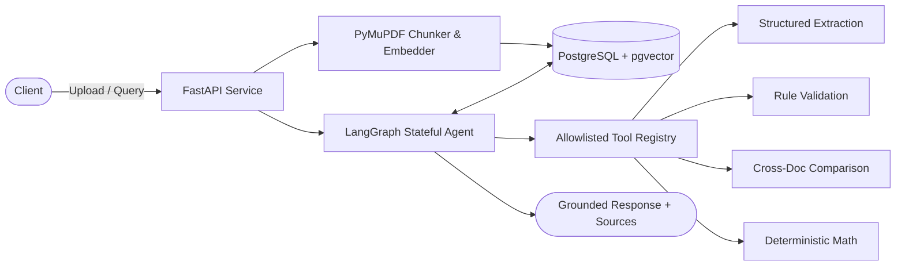

# Document Processing AI Agent

[](https://www.python.org/)
[](https://fastapi.tiangolo.com/)
[](https://langchain-ai.github.io/langgraph/)
[](https://github.com/pgvector/pgvector)
[](https://docs.pytest.org/)
[](https://github.com/astral-sh/ruff)

A backend service built with **FastAPI**, **LangGraph**, and **PostgreSQL/pgvector** for document analysis and multi-document reasoning. It parses documents (PDF, TXT, Markdown), performs RAG retrieval with provenance tracking, executes allowlisted extraction and validation tools, and returns structured responses with citations.

---

## Architecture



---

## Core Capabilities

- **Page-Aware Ingestion**: PyMuPDF extraction retaining 1-based page numbers; SHA-256 deduplication prevents redundant processing.
- **Controlled Orchestration**: Explicit LangGraph cyclical graph with bounded execution loops (max 10 steps, 6 tool calls).
- **Grounded Source Integrity**: Every extracted fact and validation result cites verifiable chunk IDs and exact excerpts.
- **Deterministic Math Engine**: Numeric operations execute pure Python arithmetic to prevent model hallucinations.
- **Security Guardrails**: Document text is treated strictly as untrusted data; prompt injections cannot override system permissions or call unallowlisted tools.
- **Dual Operating Modes**: Runs 100% offline out-of-the-box with deterministic mock embeddings, or connects directly to live OpenAI / Google Gemini models.

---

## Quick Start

### Option A: Docker Compose (Recommended)

```bash
# Start API and PostgreSQL with pgvector
docker compose up --build
```
The API is available at `http://localhost:8000`.

### Option B: Local Setup with `uv`

```bash
# 1. Install dependencies
uv sync

# 2. Copy environment variables
cp .env.example .env

# 3. Start PostgreSQL / pgvector (if not already running)
docker compose up -d db

# 4. Run the API
uv run uvicorn docproc.main:app --reload --host 0.0.0.0 --port 8000
```

---

## Interactive API Docs

Full request/response schemas, parameter validations, and live interactive testing are generated automatically by FastAPI:

- **Swagger UI**: [http://localhost:8000/docs](http://localhost:8000/docs)
- **ReDoc**: [http://localhost:8000/redoc](http://localhost:8000/redoc)

---

## Demo Walkthrough

### 1. Ingest Sample Documents
Upload the vendor quotation and corporate procurement policy:
```bash
curl -X POST "http://localhost:8000/documents" \
  -F "file=@sample_documents/Vendor_Quotation_Acme.pdf"

curl -X POST "http://localhost:8000/documents" \
  -F "file=@sample_documents/Corporate_Procurement_Policy.pdf"
```

### 2. Run an Analysis Query
Submit a query requiring extraction, rule validation, and cross-document comparison:
```bash
curl -X POST "http://localhost:8000/query" \
  -H "Content-Type: application/json" \
  -d '{
    "query": "Extract the vendor name and amount, then compare the payment terms against the policy.",
    "top_k": 5
  }'
```

The response provides extracted entities, policy discrepancy checks, citing exact document names and page numbers, and an execution trace of all tools used.

---

## Configuration & Provider Modes

Configured via environment variables in `.env`:

| Mode | Configuration | Description |
|---|---|---|
| **Offline Mock (Default)** | `LLM_PROVIDER=mock`<br>`EMBEDDING_PROVIDER=mock` | Zero external API keys needed. Generates deterministic 1536-dim vector hashes for instant, free offline testing. |
| **OpenAI** | `LLM_PROVIDER=openai`<br>`OPENAI_API_KEY=sk-...` | Live inference via `gpt-4o-mini` and `text-embedding-3-small`. |
| **Google Gemini** | `LLM_PROVIDER=gemini`<br>`GEMINI_API_KEY=AIza...` | Live inference via `gemini-1.5-flash` and `text-embedding-004`. |
| **Client BYOK (Browser-Managed)** | Set via UI modal or Request Headers | Users supply their own OpenAI or Gemini API key in the browser dashboard or via `X-OpenAI-API-Key` / `X-Gemini-API-Key` headers. Ephemeral per-request execution with **zero server persistence**. |

---

## AWS EC2 & Cloud Deployment

### 1. Launching on AWS EC2 (Ubuntu 24.04 LTS)
1. Launch a `t3.small` or `t3.micro` EC2 instance with an Ubuntu 24.04 AMI and a 20-30GB gp3 EBS disk.
2. In your Security Group, allow inbound traffic on:
   - **Port 22** (SSH)
   - **Port 80** (HTTP)
   - **Port 443** (HTTPS)
   - **Port 8000** (API & Web Dashboard)
3. SSH into the instance:
   ```bash
   ssh -i your-key.pem ubuntu@<EC2_PUBLIC_IP>
   ```
4. Run the setup script to configure Docker and swap space:
   ```bash
   git clone <YOUR_REPO_URL>
   cd ai-document-processing
   chmod +x scripts/setup_ec2.sh
   ./scripts/setup_ec2.sh
   ```
5. Start the application:
   ```bash
   docker compose up -d --build
   ```
6. Open `http://<EC2_PUBLIC_IP>:8000` in your browser.

---

## Testing & Quality Gates

```bash
# Run full test suite with coverage
uv run pytest --cov=src/docproc --cov-report=term-missing

# Run evaluation benchmark
uv run python evaluation/run_benchmark.py

# Run linter & formatter
uv run ruff check .
```
